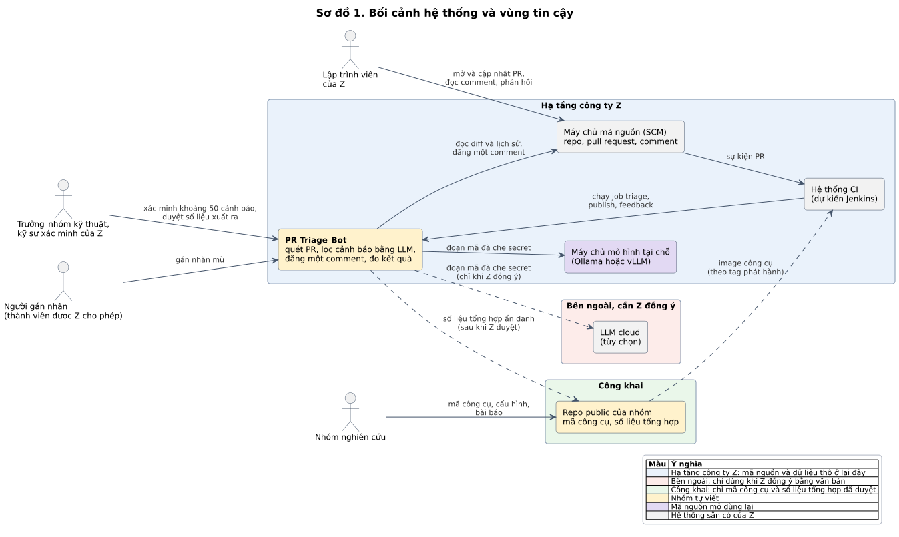
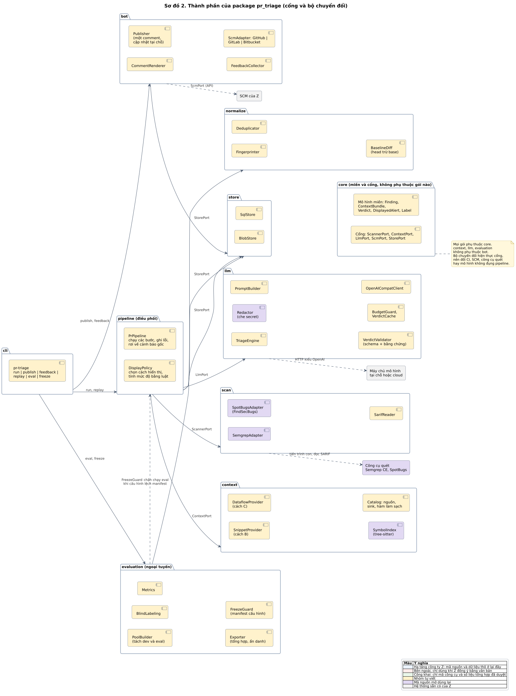
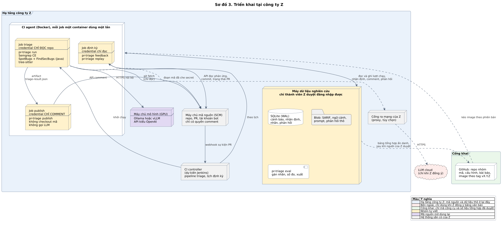
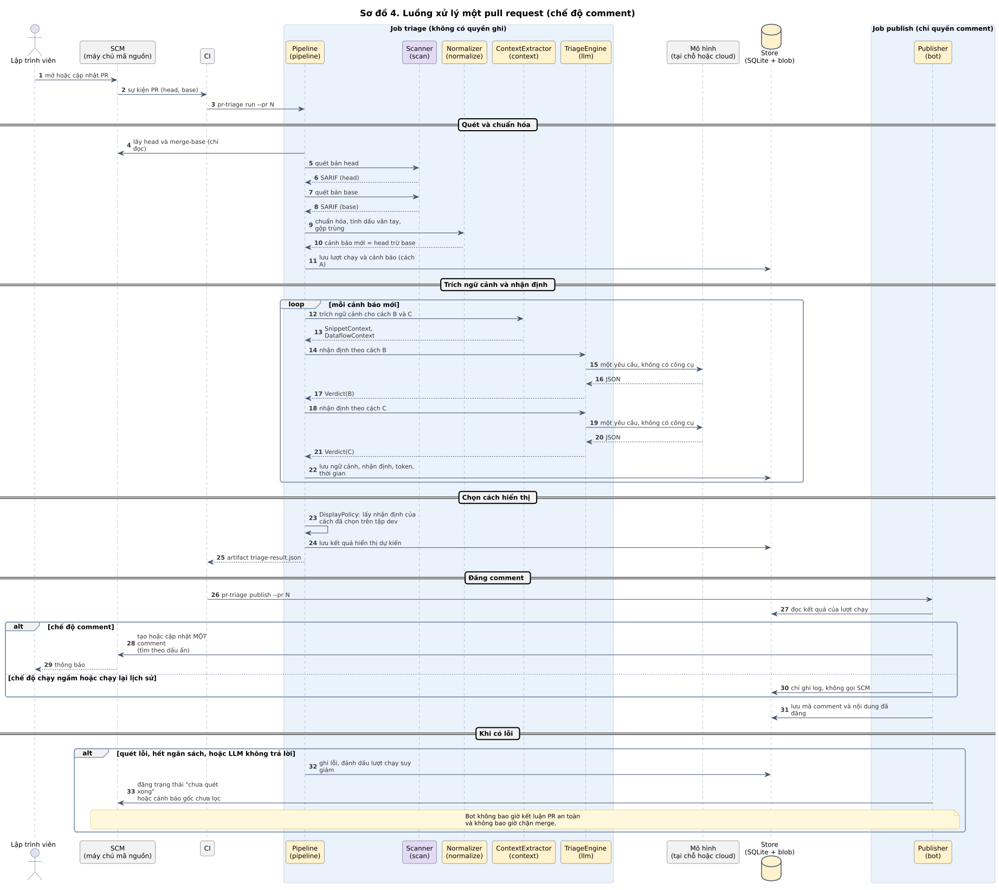
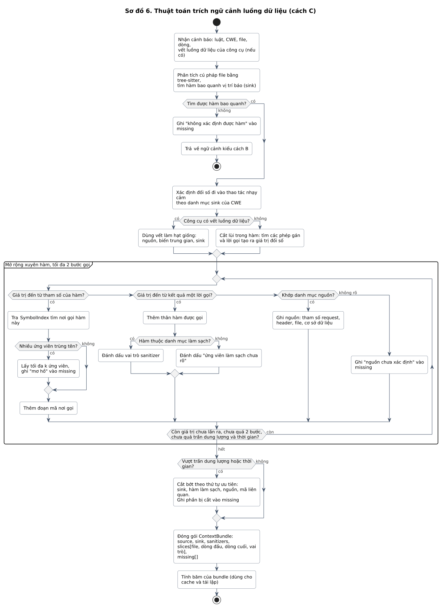
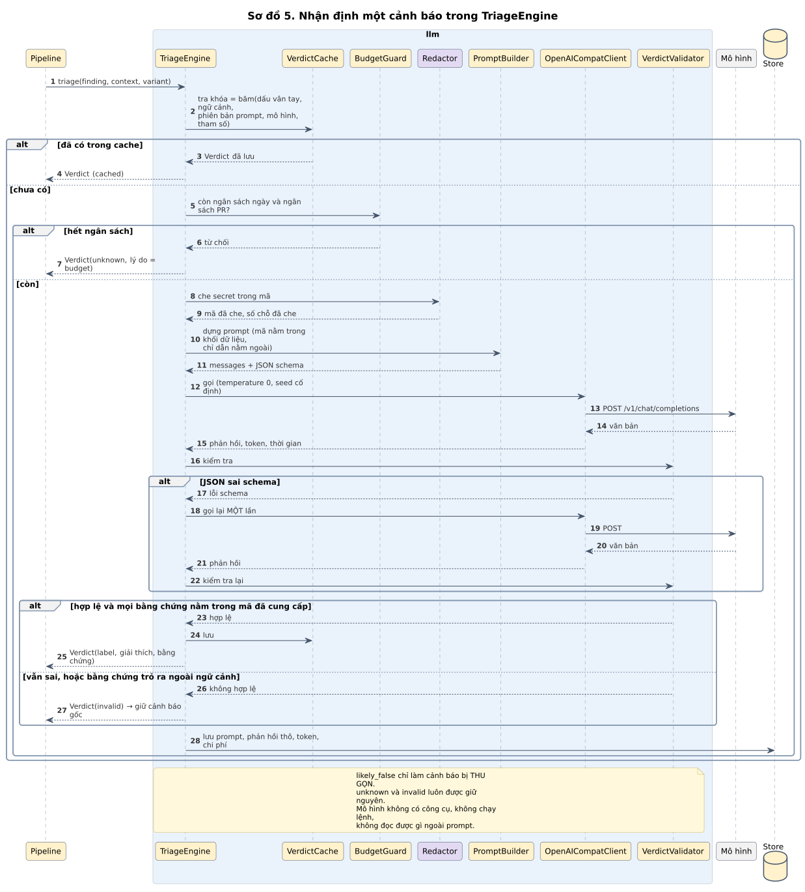
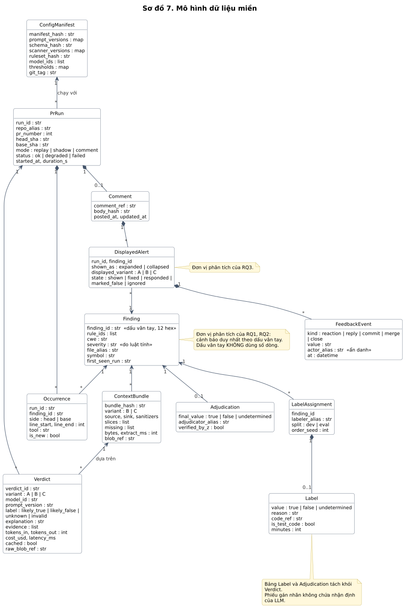
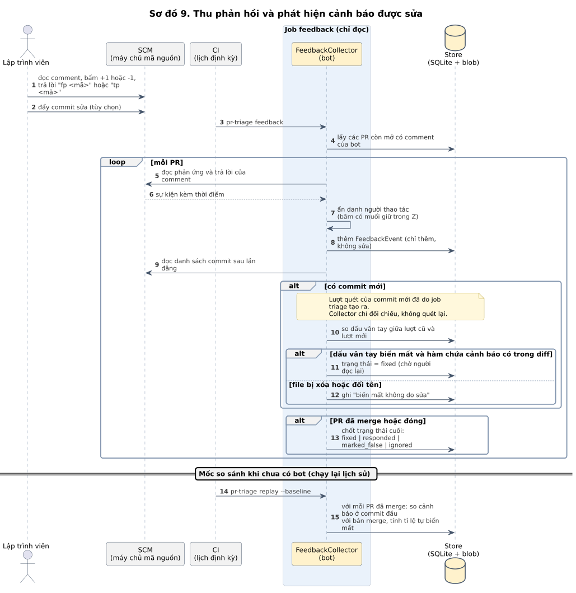
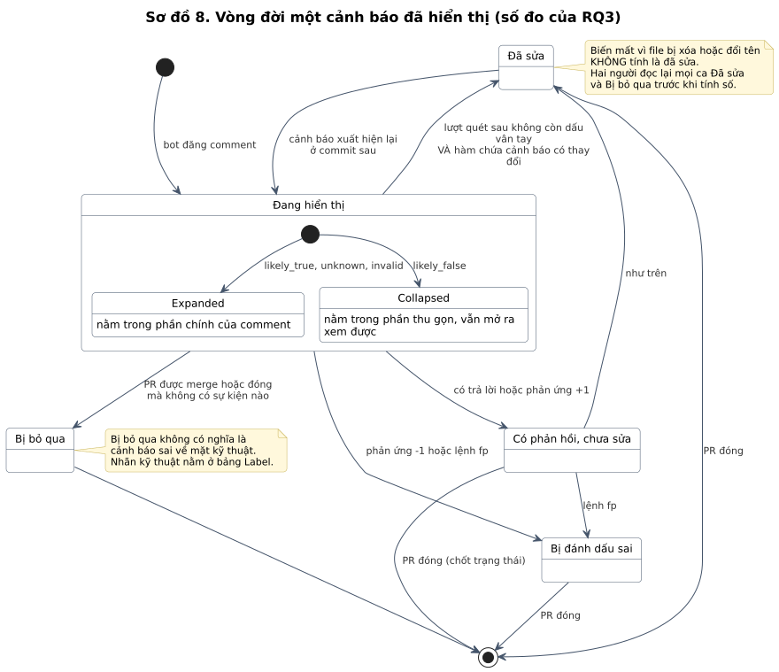
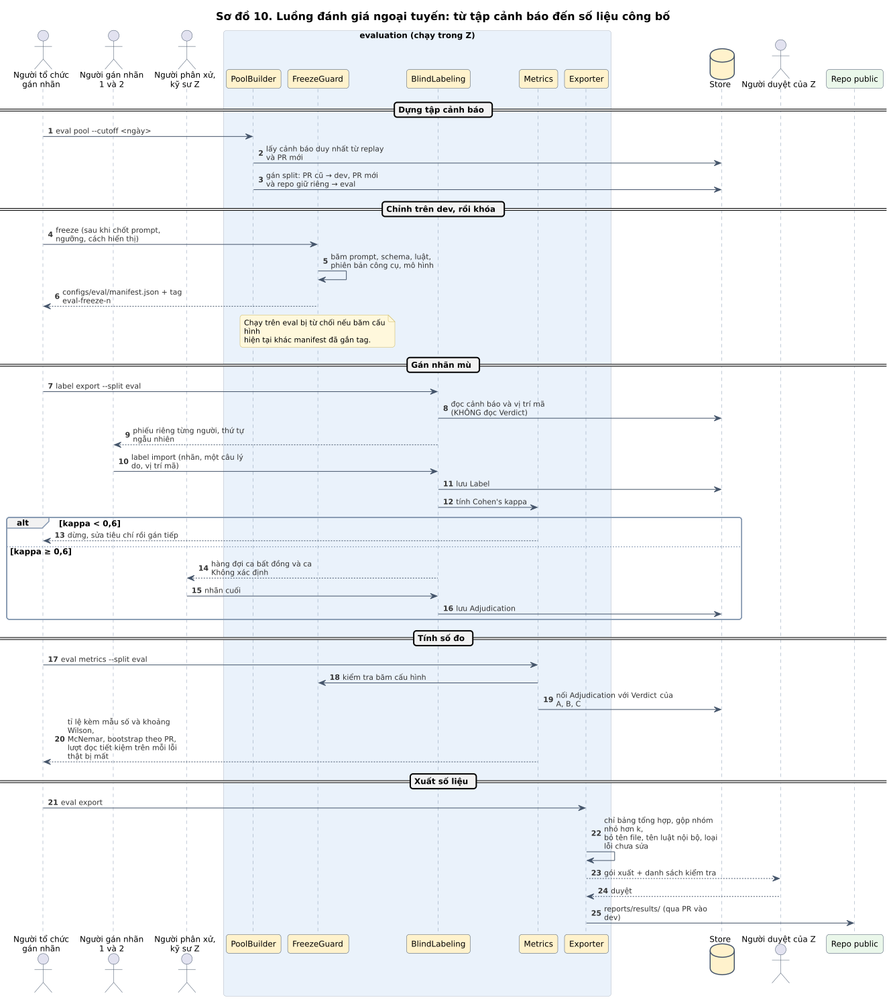

# Thiết kế hệ thống: PR Triage Bot

| | |
|---|---|
| Trạng thái | Đã được người dùng duyệt (2026-11-13). Đã hiện thực P01 đến P07, xem [kế hoạch](plans/done/) và [devlog](devlog/) |
| Phạm vi | Hệ thống chạy tại công ty Z và luồng đánh giá ngoại tuyến. Căn cứ: [proposal](project/proposal-llm-loc-canh-bao-pr.md) |
| Sơ đồ | Nguồn PlantUML ở [diagrams/](diagrams/), bản render ở `diagrams/out/`. Render lại bằng `make diagrams` |

Tài liệu này trả lời: hệ thống gồm những phần nào, phần nào tự viết và phần nào dùng lại, dữ liệu đi đâu, và điều gì còn phải quyết. Mục 12 liệt kê các giả định chưa được Z xác nhận.

## 1. Mục tiêu và ràng buộc

Hệ thống phục vụ hai việc cùng lúc: chạy như một bot trong CI của Z, và sinh dữ liệu đo cho bốn câu hỏi nghiên cứu.

| # | Ràng buộc | Nguồn | Hệ quả thiết kế |
|---|---|---|---|
| R1 | Bot chỉ comment, không chặn merge, không sửa mã | Proposal 1, 11 | Job riêng, luôn kết thúc thành công đối với PR |
| R2 | Mã nguồn, prompt chứa mã và log thô ở lại trong Z | Proposal 10 | Toàn bộ xử lý và lưu trữ nằm trong Z, chỉ xuất bảng tổng hợp |
| R3 | Mã trong PR là dữ liệu không đáng tin | Proposal 6.6 | LLM không có công cụ, đầu ra bị kiểm tra, tách quyền giữa các job |
| R4 | Ba cách A, B, C chạy trên mọi PR, bot chỉ đăng một cách | Proposal 6.2 | Mọi nhận định đều được lưu, việc hiển thị do một chính sách riêng quyết định |
| R5 | Cấu hình bị khóa trước khi chạy `eval` | Proposal 7.3 | Manifest cấu hình có băm, tag Git, bộ chặn khi lệch |
| R6 | Người gán nhãn không biết kết quả của LLM | Proposal 7.4 | Nhãn và nhận định nằm ở hai bảng, phiếu gán nhãn không đọc nhận định |
| R7 | CI, SCM, ngôn ngữ và mô hình của Z chưa biết | Phụ lục A | Cổng và bộ chuyển đổi cho bốn thứ này |
| R8 | Thời gian CI thêm vào có trung vị không quá 15 phút | Proposal 7.9 | Trần thời gian và dung lượng ở từng bước, cache nhận định |

## 2. Nguyên tắc thiết kế

1. **Công cụ tạo cảnh báo, luật tính mức độ, LLM chỉ nêu nhận định kèm bằng chứng, con người quyết định.** LLM không thêm được cảnh báo mới và không xóa được cảnh báo nào.
2. **Ngữ cảnh do chương trình trích, LLM chỉ trả lời một lần.** Không có vòng lặp agent. Nhờ đó B và C chỉ khác nhau ở đầu vào, kết quả tái lập được, và mô hình không có đường nào để chạy lệnh.
3. **Lỗi thì rơi về cảnh báo gốc.** Quét lỗi, hết ngân sách, JSON sai hay bằng chứng không hợp lệ đều dẫn tới việc giữ nguyên cảnh báo. Bot không bao giờ kết luận PR an toàn.
4. **Mọi lượt chạy đều truy được về cấu hình.** Mỗi lượt ghi băm manifest, phiên bản công cụ, mô hình và prompt.
5. **Phần thay đổi theo Z nằm sau cổng.** Đổi Jenkins sang hệ thống khác, hay đổi mô hình, không đụng tới pipeline.

## 3. Bối cảnh và vùng tin cậy



Nguồn: [01-context.puml](diagrams/01-context.puml).

Có ba vùng. Vùng của Z chứa mọi thứ có mã nguồn. Vùng cloud chỉ được dùng khi Z đồng ý bằng văn bản, và chỉ nhận đoạn mã đã che secret. Vùng công khai chỉ nhận mã công cụ và số liệu tổng hợp đã được người của Z duyệt.

## 4. Dùng lại gì từ mã nguồn mở

Nhóm không viết lại những phần đã có. Bảng dưới tách rõ ba mức: dùng trực tiếp, kế thừa ý tưởng, và cố ý không dùng.

### 4.1. Dùng trực tiếp

| Thành phần | Dùng cho | Ghi chú |
|---|---|---|
| Semgrep CE | Công cụ quét chính (cách A) | Phân tích vết của bản CE không đi xuyên file. Phạm vi chính xác cần đo bằng một ca thử trước khi viết vào báo cáo. Giấy phép của bộ luật registry cần được đọc lại trước khi dùng tại Z |
| SpotBugs + FindSecBugs | Công cụ quét thứ hai khi repo là Java | Cần mã đã biên dịch, nên tốn thời gian build. Xem rủi ro ở mục 12 |
| SARIF 2.1.0 | Định dạng trao đổi giữa công cụ quét và phần còn lại | Mọi bộ chuyển đổi công cụ quét trả về SARIF |
| tree-sitter | Phân tích cú pháp để trích ngữ cảnh | Hỗ trợ nhiều ngôn ngữ, không cần build |
| Ollama hoặc vLLM | Máy chủ mô hình tại chỗ, API kiểu OpenAI | Một client duy nhất dùng được cho cả tại chỗ và cloud |
| gitleaks hoặc detect-secrets | Che secret trong đoạn mã trước khi gửi cho LLM | Chọn một trong hai khi cài đặt |
| scipy, statsmodels, scikit-learn | Wilson, McNemar, kappa, bootstrap | Không tự viết công thức thống kê |
| Vul4J | 30 cặp bản lỗi và bản vá cho RQ4 | Theo proposal |

### 4.2. Kế thừa ý tưởng

| Dự án | Ý tưởng lấy | Khác ở đâu trong thiết kế này |
|---|---|---|
| [sast-triage](https://github.com/alexpermiakov/sast-triage) | Nhận SARIF. Nhận định phải kèm bằng chứng `file:dòng`. Cache nhận định. Trần ngân sách cho mỗi cảnh báo. Chế độ chỉ báo cáo | Dự án đó cho agent tự đọc repo bằng `read_file` và `grep_repo`. Ở đây ngữ cảnh do chương trình trích sẵn, LLM không có công cụ |
| [sift-sast](https://github.com/fadhilfathi/sift-sast) | Bộ dựng ngữ cảnh tất định bằng tree-sitter, không gọi LLM. Cảnh báo chỉ được gắn nhãn, không bị xóa | Dự án đó khớp lời gọi theo tên và có thể nhập nhằng hàm trùng tên mà không báo. Ở đây mọi chỗ mơ hồ được ghi vào `missing` để LLM và người đọc biết. Vết luồng dữ liệu của công cụ quét được dùng làm hạt giống |
| [Vulnhalla](https://github.com/cyberark/Vulnhalla) | Ba trạng thái Thật, Sai, Cần thêm dữ liệu | Ở đây `unknown` kèm danh sách `missing_context`, nhưng LLM không tự xin thêm mã |
| [IRIS](https://github.com/iris-sast/iris) | Danh mục nguồn, sink, hàm làm sạch theo từng CWE | Danh mục viết tay cho các CWE gặp ở Z, không để LLM suy luận |
| Bài phần mềm vệ tinh [1] | Khử trùng lặp bằng dấu vân tay | Áp dụng cho cả việc so head với base |

### 4.3. Cố ý không dùng

| Thứ | Lý do |
|---|---|
| CodeQL trên mã của Z | Điều khoản CodeQL hạn chế việc dùng trong CI trên mã không phải mã nguồn mở khi không có giấy phép GitHub Advanced Security. Nhóm cần đọc lại điều khoản hiện hành, và mặc định là không dùng tại Z. Có thể cân nhắc cho phần CVE công khai ở RQ4 |
| Semgrep Assistant và các dịch vụ lọc của hãng | Trả phí, gửi mã ra ngoài, và chính là thứ đề tài muốn đo một cách độc lập |
| Agent tự đọc repo | Proposal loại "agent đọc cả PR" khỏi phạm vi. Agent cũng làm B và C khó so sánh |
| reviewdog | Hợp với comment theo dòng. Đề tài cần một comment tổng hợp có phần thu gọn |
| DefectDojo | Quá nặng cho một đợt chạy vài tuần |

Phương án mở: **Joern** cho phân tích luồng dữ liệu xuyên hàm trên Java. Nếu trên tập `dev` bộ trích bằng tree-sitter để lại quá nhiều `missing`, nhóm thay bộ hiện thực của `ContextPort` bằng Joern. Giấy phép và thời gian chạy của Joern cần được kiểm tra trước.

## 5. Thành phần



Nguồn: [02-component.puml](diagrams/02-component.puml).

| Gói | Trách nhiệm | Người phụ trách (proposal 13) |
|---|---|---|
| `core` | Mô hình miền và năm cổng. Không phụ thuộc gói nào | Chung |
| `pipeline` | Điều phối các bước của một lượt chạy, xử lý lỗi, chính sách hiển thị | QuangHa0110 |
| `scan` | Chạy công cụ quét như tiến trình con, đọc SARIF | QuangHa0110 |
| `normalize` | Dấu vân tay, khử trùng lặp, lấy cảnh báo mới bằng head trừ base | QuangHa0110 |
| `context` | Trích ngữ cảnh cho cách B và C | trinq |
| `llm` | Che secret, dựng prompt, gọi mô hình, kiểm tra đầu ra, ngân sách, cache | Chưa có tên |
| `bot` | Dựng và đăng comment, bộ chuyển đổi SCM, thu phản hồi | KienTranDSAI |
| `store` | SQLite và kho blob | Cùng người làm `pipeline` |
| `evaluation` | Dựng tập cảnh báo, gán nhãn mù, số đo, xuất số liệu, khóa cấu hình | hotamago và người tổ chức gán nhãn |

Cả chín gói đã có trong `src/pr_triage/`.

**Quy tắc phụ thuộc.** Mọi gói phụ thuộc `core`. `context`, `llm` và `evaluation` không phụ thuộc `bot`. Chỉ `pipeline` và `cli` được nối các gói với nhau.

### 5.1. Năm cổng

| Cổng | Phương thức chính | Bộ hiện thực ban đầu |
|---|---|---|
| `ScannerPort` | `scan(checkout, paths) -> Sarif` | `SemgrepAdapter`, `SpotBugsAdapter` |
| `ContextPort` | `extract(finding, checkout) -> ContextBundle` | `SnippetProvider` (B), `DataflowProvider` (C) |
| `LlmPort` | `triage(finding, bundle, variant) -> Verdict` | `TriageEngine` trên `OpenAICompatClient` |
| `ScmPort` | `get_pr`, `list_commits`, `upsert_comment`, `list_reactions`, `list_replies` | Một bộ cho SCM của Z, chọn sau Phụ lục A |
| `StorePort` | Lưu và đọc các thực thể ở mục 9 | `SqlStore`, `BlobStore` |

### 5.2. Giao diện dòng lệnh

| Lệnh | Chạy ở đâu | Việc |
|---|---|---|
| `pr-triage run --pr N` | Job triage | Quét, chuẩn hóa, trích ngữ cảnh, nhận định, lưu, ghi `triage-result.json` |
| `pr-triage publish --pr N` | Job publish | Đọc kết quả, đăng hoặc cập nhật một comment |
| `pr-triage feedback` | Job định kỳ | Thu phản ứng, trả lời, commit, trạng thái PR |
| `pr-triage replay --from --to` | Job theo lô | Chạy lại trên PR đã merge, không gọi SCM để ghi |
| `pr-triage eval pool \| label-export \| label-import \| metrics \| export` | Máy dữ liệu | Luồng đánh giá ở mục 10 |
| `pr-triage freeze` | Máy dữ liệu | Tạo manifest cấu hình |

## 6. Triển khai



Nguồn: [03-deployment.puml](diagrams/03-deployment.puml).

- **Ba job, ba mức quyền.** Job triage đọc mã và gọi LLM nhưng không có token ghi. Job publish có quyền comment nhưng không checkout mã và không gọi LLM. Nó chỉ đọc kết quả đã qua kiểm tra. Một PR độc hại vì thế không thể vừa điều khiển LLM vừa chạm vào token ghi.
- **Một image.** Image `pr-triage` được dựng từ tag phát hành `vX.Y.Z` của repo public và được kéo vào Z theo đúng phiên bản.
- **Lưu trữ.** SQLite ở chế độ WAL trên một máy trong Z, cùng một thư mục blob. Các job CI chạy tuần tự cho mỗi PR nên SQLite đủ dùng. Nếu Z chạy nhiều job song song trên nhiều agent, đổi `SqlStore` sang PostgreSQL.
- **Ba chế độ chạy** theo các giai đoạn ở proposal 8.1: `replay` (PR đã merge), `shadow` (PR mới, chỉ ghi log), `comment` (đăng comment). Chế độ là một tham số của lượt chạy, mã không đổi.

## 7. Luồng xử lý một pull request



Nguồn: [04-seq-pr-flow.puml](diagrams/04-seq-pr-flow.puml).

### 7.1. Quét và lấy cảnh báo mới

Pipeline quét cả bản head và bản merge-base, rồi lấy hiệu theo dấu vân tay. Cách này dùng được cho mọi công cụ quét, kể cả công cụ không có chế độ quét theo diff.

**Dấu vân tay** là băm SHA-256 của bộ: mã luật, đường dẫn tương đối, tên đầy đủ của hàm bao quanh, đoạn mã khớp đã bỏ khoảng trắng, và số thứ tự của lần khớp trong hàm. Số dòng không tham gia, nên dấu vân tay không đổi khi mã phía trên bị thêm bớt. `finding_id` là 12 ký tự hex đầu.

**Gộp trùng giữa các công cụ:** hai cảnh báo cùng CWE, cùng file, cùng hàm và có vùng sink chồng nhau được coi là một cảnh báo duy nhất có nhiều nguồn.

### 7.2. Chính sách hiển thị

`DisplayPolicy` đọc `configs/eval/display-policy.yml`, là kết quả của quy tắc chọn ở proposal 6.2 áp trên tập `dev`. Nó quyết định ba việc: lấy nhận định của cách nào, cảnh báo nào được thu gọn, và mức độ của từng cảnh báo. Mức độ tính bằng bảng tra theo luật và CWE, không lấy từ LLM.

Khi không cách nào đạt ngưỡng, chính sách chuyển sang chế độ chỉ chú thích: mọi cảnh báo đều mở, nhận định của LLM chỉ là một dòng ghi chú.

### 7.3. Comment

Mỗi PR có đúng một comment của bot. `Publisher` tìm comment cũ bằng một dấu ẩn `<!-- pr-triage:v1 -->` rồi cập nhật tại chỗ, nên việc chạy lại không sinh comment mới. Cảnh báo `likely_false` nằm trong khối `<details>`.

### 7.4. Các chế độ suy giảm

| Sự cố | Hành vi | Trạng thái lượt chạy |
|---|---|---|
| Công cụ quét lỗi hoặc quá thời gian | Đăng "chưa quét xong", không liệt kê cảnh báo | `failed` |
| Trích ngữ cảnh C lỗi | Dùng ngữ cảnh kiểu B cho cảnh báo đó, ghi vào `missing` | `degraded` |
| LLM không trả lời hoặc hết ngân sách | Đăng cảnh báo gốc chưa lọc | `degraded` |
| JSON sai sau một lần gọi lại | Cảnh báo đó được giữ nguyên, nhãn `invalid` | `ok` |
| Không ghi được vào kho | Không đăng comment, job báo lỗi cho người vận hành | `failed` |

Trong mọi trường hợp, job không làm PR bị chặn.

## 8. Hai phần lõi kỹ thuật

### 8.1. Trích ngữ cảnh luồng dữ liệu (cách C)



Nguồn: [06-act-context.puml](diagrams/06-act-context.puml).

Đây là phần phân tích chương trình của đề tài. Bộ trích lần ngược từ sink về nguồn, tối đa hai bước gọi, và đóng gói thành một `ContextBundle`:

```json
{
  "bundle_hash": "9c1e…",
  "variant": "C",
  "sink": {"file": "…/OrderDao.java", "line": 42, "kind": "sql-query", "argument": "filter"},
  "source": {"kind": "request-parameter", "file": "…/OrderController.java", "line": 18},
  "sanitizers": [{"symbol": "QueryUtils.buildFilter", "status": "candidate"}],
  "slices": [{"file": "…/QueryUtils.java", "start": 30, "end": 52, "role": "sanitizer"}],
  "missing": ["callers of OrderDao.find: 3 ứng viên trùng tên, lấy 2"]
}
```

Ba quyết định đáng chú ý:

- **Cách B và C dùng chung prompt và schema.** Chỉ khác ở phần dữ liệu. Nếu không, sự khác biệt đo được có thể đến từ prompt.
- **`missing` là dữ liệu hạng nhất.** Bộ trích dựa trên cú pháp nên sẽ có chỗ không lần ra. Ghi rõ chỗ đó giúp LLM trả `unknown` thay vì đoán, và cho nhóm một số đo về độ phủ của bộ trích.
- **Trần dung lượng và thời gian** được chốt trên tập `dev` và nằm trong manifest. Khi vượt trần, bộ trích cắt theo thứ tự ưu tiên: giữ sink, rồi hàm làm sạch, rồi nguồn, rồi mã liên quan.

Danh mục nguồn, sink và hàm làm sạch nằm ở `configs/context/`, chia theo ngôn ngữ và CWE.

### 8.2. Nhận định bằng LLM



Nguồn: [05-seq-triage.puml](diagrams/05-seq-triage.puml).

- **Đầu ra** theo schema ở proposal 6.4, lưu tại `configs/schemas/verdict.schema.json`.
- **Kiểm tra bằng chứng.** Mỗi mục `evidence` phải trỏ vào một dòng nằm trong các `slices` đã gửi. Bằng chứng trỏ ra ngoài làm nhận định thành `invalid`. Đây là hàng rào chính chống việc mô hình bịa.
- **Chống chèn lệnh qua mã.** Mã nằm trong khối dữ liệu có phân cách, chỉ dẫn nằm ngoài. Mô hình không có công cụ. Hậu quả xấu nhất của một lần chèn lệnh thành công là một cảnh báo bị thu gọn, và nó vẫn mở ra xem được.
- **Tái lập.** `temperature` bằng 0, `seed` cố định khi mô hình hỗ trợ. Độ dao động vẫn được đo bằng cách chạy lại ba lần trên 50 cảnh báo.
- **Cache.** Khóa là băm của dấu vân tay, băm ngữ cảnh, phiên bản prompt, mã mô hình và tham số. Khi PR được cập nhật mà ngữ cảnh của một cảnh báo không đổi, nhận định cũ được dùng lại. Các lần chạy đo độ dao động tắt cache.
- **Ngân sách.** Có trần cho mỗi ngày và cho mỗi PR. Mọi lần gọi ghi số token, chi phí và thời gian.

## 9. Mô hình dữ liệu



Nguồn: [07-domain-model.puml](diagrams/07-domain-model.puml).

- `Finding` là cảnh báo duy nhất, đơn vị phân tích của RQ1 và RQ2. `Occurrence` là một lần cảnh báo đó xuất hiện trong một lượt quét.
- `Verdict` lưu cho cả ba cách, kể cả cách không được hiển thị. Cách A có một `Verdict` hình thức với nhãn `likely_true` cho mọi cảnh báo, để ba cách so sánh trên cùng một bảng.
- `DisplayedAlert` là đơn vị phân tích của RQ3.
- `Label` và `Adjudication` tách hẳn khỏi `Verdict`.
- Tên file, tên người và tên repo được lưu dưới dạng bí danh. Bảng ánh xạ bí danh nằm trong Z và không bao giờ được xuất.

## 10. Đo lường

### 10.1. Thu phản hồi và phát hiện cảnh báo được sửa



Nguồn: [09-seq-feedback.puml](diagrams/09-seq-feedback.puml).



Nguồn: [08-state-alert.puml](diagrams/08-state-alert.puml).

Một cảnh báo được tính là **đã sửa** khi thỏa cả hai điều kiện: dấu vân tay không còn ở lượt quét sau, và hàm chứa cảnh báo có trong diff. Trường hợp file bị xóa hoặc đổi tên được ghi riêng. Hai người đọc lại mọi ca "đã sửa" và "bị bỏ qua" trước khi tính số.

**Vấn đề cần nhóm quyết.** Proposal mô tả phản hồi bằng 👍 và 👎 trên comment. Một comment chứa nhiều cảnh báo, nên một phản ứng không cho biết nó nói về cảnh báo nào. Thiết kế này đề xuất ba kênh:

1. Phản ứng trên comment tổng: tính cho cả comment, dùng cho câu hỏi "comment có ích không".
2. Trả lời `fp <mã>` hoặc `tp <mã>`: phản hồi cho từng cảnh báo.
3. Comment theo dòng cho cảnh báo mức High (mục "nên có" của proposal): mỗi comment có phản ứng riêng.

### 10.2. Đánh giá ngoại tuyến



Nguồn: [10-seq-evaluation.puml](diagrams/10-seq-evaluation.puml).

- **Tách tập.** `PoolBuilder` chia theo thời gian merge của PR. Nếu có nhiều repo, một repo chỉ dùng cho `eval`.
- **Khóa cấu hình.** `pr-triage freeze` tạo `configs/eval/manifest.json` chứa băm của prompt, schema, bộ luật, danh mục ngữ cảnh, phiên bản công cụ, mã mô hình và các ngưỡng. Commit đó được gắn tag `eval-freeze-<n>`. Lệnh `eval metrics --split eval` từ chối chạy khi băm hiện tại khác manifest.
- **Gán nhãn mù.** Phiếu xuất ra chứa cảnh báo, vị trí mã và tiêu chí. Mã xuất phiếu không truy vấn bảng `Verdict`. Thứ tự được xáo riêng cho từng người. Người làm `context` và `llm` không có tên trong danh sách phân phiếu.
- **Xuất số liệu.** `Exporter` chỉ xuất bảng tổng hợp, gộp các nhóm nhỏ hơn ngưỡng k, bỏ tên file và loại lỗi chưa sửa. Gói xuất đi qua người duyệt của Z, rồi vào repo public bằng một PR.

Phần hiệu chuẩn bằng CVE (RQ4) chạy cùng pipeline ở chế độ `replay` trên 30 cặp bản lỗi và bản vá, với mô tả PR đã viết lại cho trung tính. Phần này chạy được ngoài Z vì dữ liệu công khai.

## 11. Ánh xạ sang câu hỏi nghiên cứu

| RQ | Dữ liệu lấy từ | Thành phần tạo ra |
|---|---|---|
| RQ1 hiện trạng | `Finding`, `Occurrence`, `Adjudication` | `scan`, `normalize`, `evaluation` |
| RQ2 lọc và ngữ cảnh | `Verdict` của A, B, C nối với `Adjudication` | `context`, `llm`, `evaluation` |
| RQ2 tại chỗ so với cloud | `Verdict` theo `model_id` | `llm` |
| RQ3 lập trình viên | `DisplayedAlert`, `FeedbackEvent`, thời gian và chi phí ở `PrRun`, `Verdict` | `bot`, `pipeline` |
| RQ4 hiệu chuẩn | Lượt chạy `replay` trên các cặp CVE | Toàn bộ pipeline |

## 12. Giả định, rủi ro và việc còn phải quyết

### 12.1. Giả định chưa được Z xác nhận

| # | Giả định | Nếu sai thì đổi gì |
|---|---|---|
| G1 | CI là Jenkins và chạy được container | Viết lại file pipeline. Mã không đổi |
| G2 | SCM có API để comment, đọc phản ứng và đọc commit | Viết một `ScmAdapter` khác. Nếu không đọc được phản ứng thì chỉ còn kênh trả lời |
| G3 | Ngôn ngữ chính là Java | Đổi danh mục ngữ cảnh và grammar tree-sitter. Bỏ SpotBugs nếu không phải Java |
| G4 | Z có máy chạy được mô hình tại chỗ, hoặc cho gửi mã lên cloud | Thiếu cả hai thì không có cách B và C |
| G5 | Có một máy trong Z để lưu dữ liệu nghiên cứu | Cần thỏa thuận lại với Z |

### 12.2. Rủi ro kỹ thuật

| Rủi ro | Dấu hiệu | Cách xử lý |
|---|---|---|
| SpotBugs cần build, làm chạy lại lịch sử 100–200 PR rất chậm | Thời gian một lượt replay vượt vài phút | Replay chỉ dùng Semgrep, SpotBugs chỉ chạy trên PR mới |
| Bộ trích bằng tree-sitter để lại nhiều `missing` | Tỉ lệ bundle có `missing` trên `dev` cao | Chuyển `ContextPort` sang Joern cho Java |
| Dấu vân tay đổi khi mã được định dạng lại | Cùng một cảnh báo bị tính là mới sau commit định dạng | Kiểm thử dấu vân tay trên các commit chỉ đổi định dạng trước khi chạy replay |
| Mô hình tại chỗ quá chậm cho trần 15 phút | Trung vị thời gian job vượt trần trên `dev` | Giảm trần ngữ cảnh, chạy B và C song song, hoặc chỉ chạy cách được hiển thị trong giờ cao điểm |
| Phát hiện "đã sửa" sai | Người đọc lại bác nhiều ca | Siết điều kiện, báo cáo cả số trước và sau khi đọc lại |

### 12.3. Việc cần nhóm quyết

1. Kênh phản hồi cho từng cảnh báo (mục 10.1).
2. Công cụ gán nhãn: phiếu CSV do `eval label-export` sinh ra, hay một công cụ như Label Studio chạy trong Z.
3. Mô hình tại chỗ và mô hình cloud cụ thể, cùng ngân sách.
4. Thêm ba gói `core`, `pipeline`, `store` vào khung repo và chia lại người phụ trách.
5. Có fork `sast-triage` để lấy khung Action không, hay chỉ kế thừa ý tưởng như thiết kế này.

## 13. Thứ tự xây dựng đề xuất

Thứ tự này đi theo các mốc ở proposal 12 và để mỗi bước chạy thử được trên một repo mã nguồn mở trước khi vào Z.

| Bước | Nội dung | Kết quả kiểm chứng được |
|---|---|---|
| 1 | `core`, `store`, `scan` với Semgrep, `normalize` | `pr-triage run` in ra cảnh báo mới của một PR mẫu. Đây là cách A |
| 2 | `llm` với `SnippetProvider` | Có `Verdict` cách B, được lưu kèm token và thời gian |
| 3 | `context` với `DataflowProvider` | Có `Verdict` cách C và số đo `missing` |
| 4 | `bot` ở chế độ `shadow` rồi `comment`, `replay` | Một comment trên PR thử, chạy lại không sinh comment mới |
| 5 | `evaluation`: tập cảnh báo, phiếu mù, số đo, `freeze` | Bảng số đo trên `dev`, manifest và tag |
| 6 | `feedback` và phát hiện "đã sửa" | Trạng thái cuối cho các PR thử |

Bước 1 đến 3 không cần quyền truy cập Z và có thể bắt đầu ngay.
