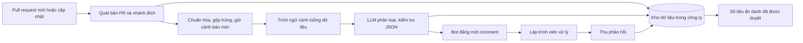
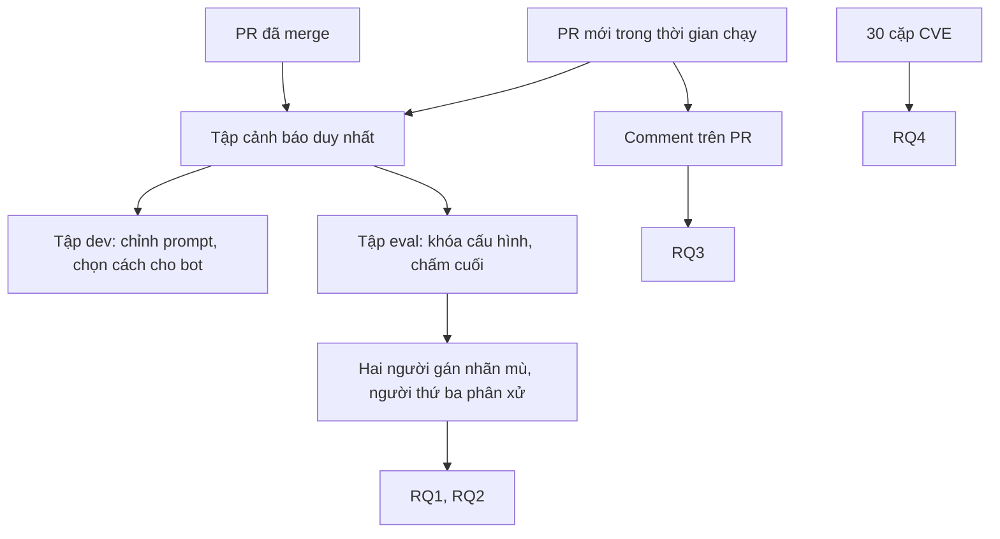

# Proposal đề tài 3TT

**LLM lọc cảnh báo bảo mật trên pull request có đáng dùng ở doanh nghiệp không? Nghiên cứu trường hợp triển khai tại công ty Z**

Bản tiếng Anh: *Does LLM Triage of Security Alerts Pay Off at Pull Request Time? An Industrial Case Study*

| | |
|---|---|
| Học phần | IT5440 Nguyên lý và kỹ thuật phân tích chương trình, học kỳ 2026.1 |
| Giảng viên | PGS.TS. Huỳnh Quyết Thắng |
| Nhóm | Nhóm 7, 7 học viên |
| Đề tài | 3TT, Chương 11: Phân tích chương trình hướng bảo mật, hướng đánh giá triển khai thực tế |
| Trạng thái | Bản đề nghị để nhóm biểu quyết ngày 09/11/2026. Công ty Z chưa chốt các điều kiện ở Phụ lục A |
| Nguồn ý tưởng | Trục chính từ đề xuất của hotamago, ngữ cảnh luồng dữ liệu từ đề xuất của trinq |

## 1. Tóm tắt

Công cụ phân tích tĩnh tìm được lỗi bảo mật nhưng cũng báo nhiều cảnh báo sai. Nhiều nghiên cứu gần đây dùng LLM để lọc cảnh báo sai và đạt kết quả rất cao. Phần lớn các kết quả đó đo ở nơi có rất nhiều cảnh báo sai, và không đo lập trình viên có sửa lỗi hay không.

Đề tài triển khai một bot trong CI của công ty Z. Khi có pull request (PR), bot quét phần mã thay đổi, dùng LLM phân loại cảnh báo, rồi đăng một comment. Bot không chặn merge và không sửa mã.

Nhóm so sánh ba cách trên cùng tập cảnh báo đã gán nhãn:

- **A:** chỉ công cụ quét.
- **B:** công cụ quét và LLM, chỉ đưa vài dòng mã quanh cảnh báo.
- **C:** như B, thêm ngữ cảnh luồng dữ liệu gồm nguồn dữ liệu, hàm làm sạch và thao tác nhạy cảm.

Nhóm đo bốn việc: hiện trạng cảnh báo trên mã của Z, giá trị của việc lọc, phản ứng của lập trình viên, và mức tương đồng với kết quả trên CVE công khai.

**Đóng góp chính:** số liệu từ CI thật của một doanh nghiệp về việc LLM lọc cảnh báo bảo mật có đáng dùng không, tính theo đúng tỉ lệ cảnh báo sai của doanh nghiệp đó và hành động thật của lập trình viên. Kết quả âm vẫn được báo cáo.

## 2. Bối cảnh và vấn đề

Ba vấn đề làm cho việc đưa công cụ phân tích tĩnh vào quy trình phát triển trở nên khó:

1. **Cảnh báo sai làm mất niềm tin.** Google coi một cảnh báo là "cảnh báo sai hiệu dụng" nếu lập trình viên không có hành động tích cực sau khi thấy nó, và yêu cầu kiểm tra trong code review có dưới 10% loại này [13].
2. **Thời điểm báo quan trọng.** Facebook ghi nhận tỉ lệ sửa gần 0% khi gửi danh sách lỗi riêng, và hơn 70% khi báo lúc review [14]. Nghiên cứu này không dùng LLM.
3. **Con số đẹp của LLM có thể không áp dụng được.** Giá trị của bộ lọc phụ thuộc vào tỉ lệ cảnh báo sai ban đầu.

Ví dụ sau do nhóm tự tính. Giả sử bộ lọc loại được 95% cảnh báo sai và loại nhầm 5% lỗi thật.

| Trên 100 cảnh báo | Cảnh báo sai được loại | Lỗi thật bị mất | Lượt đọc tiết kiệm trên mỗi lỗi thật bị mất |
|---|---|---|---|
| 90 cảnh báo sai | 85,5 | 0,5 | 171 |
| 22 cảnh báo sai | 20,9 | 3,9 | 5,4 |

Cùng một bộ lọc, giá trị chênh khoảng 30 lần. Muốn biết bộ lọc có đáng dùng ở Z không thì phải đo trên dữ liệu của Z.

## 3. Tổng quan và khoảng trống

### 3.1. Bốn bài báo được giao

| Bài | Kết quả liên quan | Nhóm sử dụng |
|---|---|---|
| Phần mềm vệ tinh [1] | Quét 126 repo, gán nhãn 360 mẫu, 22,2% cảnh báo sai | Quy trình quét nhiều lớp, khử trùng lặp bằng dấu vân tay, ước lượng tỉ lệ cảnh báo sai kèm khoảng tin cậy |
| QLCoder [2] | Agent LLM viết truy vấn CodeQL, chấm bằng tiêu chí báo trên bản lỗi và im trên bản vá | Tiêu chí chấm 30 cặp CVE ở RQ4 |
| GONDAR [3] | LLM tập trung vào sink nguy hiểm trong khám phá lỗ hổng Java | Trọng tâm vào sink khi trích ngữ cảnh ở cách C |
| P2Patch [4] | Tách bộ đáp án khỏi quá trình tạo kết quả | Tách `dev` và `eval`, gán nhãn mù |

### 3.2. Nghiên cứu gần nhất

| Nghiên cứu | Đã làm | Chưa trả lời |
|---|---|---|
| Sifting the Noise [5] | So sánh agent LLM lọc cảnh báo. Trên OWASP Benchmark, tỉ lệ cảnh báo sai ban đầu trên 92%. Trên dự án Java với CodeQL, nhận ra tới 93,3% cảnh báo sai | Không đo tại doanh nghiệp, không đo hành động của lập trình viên |
| Nghiên cứu tại Tencent [6] | 433 cảnh báo công nghiệp, 76% là sai, loại được 94–98% cảnh báo sai với 0,0011–0,12 USD mỗi cảnh báo | Ba loại lỗi phổ biến, không nhắm vào lỗ hổng bảo mật. Không đo trên PR |
| IRIS [7], ZeroFalse [8], LLM4FPM [9] | Dùng LLM và ngữ cảnh mã để giảm cảnh báo sai trên bộ dữ liệu chuẩn | Dữ liệu có đáp án sẵn, không có lập trình viên |
| AgenticSCR [10] | Agent review bảo mật trên PR. Chạy ngầm trong công nghiệp, kỹ sư bảo mật xác nhận 54% comment | Là agent tự review, không lọc cảnh báo của công cụ. Do kỹ sư bảo mật đánh giá, chưa đo lập trình viên sửa lỗi |
| RovoDev tại Atlassian [11] | 38,7% comment của LLM dẫn đến thay đổi mã | Review mã nói chung, không riêng bảo mật |
| Công cụ tĩnh trong secure code review [12] | Một công cụ gắn cờ hàm có lỗi ở 52% commit đưa lỗi vào | Không dùng LLM |

### 3.3. Khoảng trống

Theo những gì nhóm tìm được, chưa có báo cáo kết hợp đủ ba yếu tố: cảnh báo bảo mật từ công cụ phân tích tĩnh đã qua LLM lọc, hiển thị trên PR thật của doanh nghiệp, và đo bằng hành động của lập trình viên. Nhóm cũng chưa thấy so sánh trực tiếp giữa mô hình chạy trên máy và mô hình cloud cho việc này.

"Chưa thấy" chỉ có nghĩa là khảo sát hiện tại chưa tìm ra. Nhóm tiếp tục khảo sát đến 17/11 và sẽ điều chỉnh đóng góp nếu có công trình trùng.

## 4. Câu hỏi nghiên cứu và giả thuyết

| RQ | Câu hỏi | Giả thuyết bác bỏ được |
|---|---|---|
| **RQ1. Hiện trạng** | Trên mã của Z, công cụ quét báo bao nhiêu cảnh báo, bao nhiêu là sai, và lập trình viên hiện xử lý ra sao? | H1: Tỉ lệ cảnh báo sai của Z thấp hơn 76%, mức thấp nhất trong các nghiên cứu [5], [6] |
| **RQ2. Lọc và ngữ cảnh** | LLM loại được bao nhiêu cảnh báo sai, loại nhầm bao nhiêu lỗi thật? Ngữ cảnh luồng dữ liệu có giúp không? Mô hình chạy trên máy khác mô hình cloud thế nào? | H2a: C loại nhầm ít lỗi thật hơn B. H2b: C loại cảnh báo sai không kém B. H2c: Mức loại nhầm lỗi thật của mô hình chạy trên máy cao hơn mô hình cloud không quá 10 điểm phần trăm |
| **RQ3. Lập trình viên** | Cảnh báo trên PR có được sửa không? Lập trình viên đánh giá ra sao? CI chậm thêm bao lâu, tốn bao nhiêu tiền? | H3: Tỉ lệ cảnh báo được sửa khi có bot cao hơn tỉ lệ cảnh báo tự biến mất trên các PR trước khi có bot |
| **RQ4. Hiệu chuẩn (phụ)** | Trên 30 cặp CVE, thứ tự các cách có giống trên mã của Z không? Mô hình có thuộc sẵn CVE cũ không? | H4: Kết quả trên CVE cũ tốt hơn CVE năm 2026 |

RQ1 là phần khảo sát hiện trạng, RQ3 là phần đo hiệu quả triển khai. RQ2 là phần so sánh kỹ thuật. Các ngưỡng trên là điểm xuất phát và được khóa trước khi chạy trên tập `eval`.

## 5. Đóng góp và triết lý khoa học

### 5.1. Đóng góp dự kiến

- **C1.** Số liệu về hành động của lập trình viên với cảnh báo bảo mật đã qua LLM lọc trên PR thật, tại một doanh nghiệp phần mềm.
- **C2.** Phân tích giá trị của bộ lọc theo tỉ lệ cảnh báo sai nền, bằng số đo lượt đọc tiết kiệm trên mỗi lỗi thật bị mất.
- **C3.** Đo tác dụng của ngữ cảnh luồng dữ liệu từ phân tích chương trình đối với LLM, trên mã độc quyền mà mô hình chưa từng thấy công khai.
- **C4.** Quy trình và mã nguồn để doanh nghiệp khác lắp vào CI, cùng giao thức hiệu chuẩn có kiểm soát việc mô hình thuộc CVE.

### 5.2. Triết lý khoa học

- **Cảnh báo chỉ có giá trị khi dẫn đến hành động.** Nhãn kỹ thuật cho biết cảnh báo đúng hay sai. Hành động của lập trình viên cho biết cảnh báo có ích không. Nhóm đo cả hai và không trộn chúng.
- **LLM chỉ đề xuất.** Công cụ tạo cảnh báo, script tính mức độ, LLM nêu nhận định kèm bằng chứng, và con người quyết định.
- **Bằng chứng tạo ra kết quả không được dùng để chấm chính kết quả đó** [4].
- **Mọi giả thuyết phải bác bỏ được.** Nếu LLM không đáng dùng ở Z, đó vẫn là kết quả có giá trị.
- **Đây là nghiên cứu trường hợp.** Mục đích là hiểu sâu một doanh nghiệp, không khái quát cho mọi doanh nghiệp [15].

## 6. Giải pháp

### 6.1. Luồng trên pull request



Mọi xử lý chạy trong hạ tầng của Z. Stack dự kiến là Semgrep CE, SpotBugs với FindSecBugs nếu Z dùng Java, Jenkins, Docker và Python. Công cụ và CI sẽ đổi theo hệ thống Z đang dùng.

### 6.2. Ba cách so sánh

| Cách | Đầu vào của LLM | Vai trò trên PR |
|---|---|---|
| A | Không dùng LLM | Mốc so sánh, chạy ngầm |
| B | Cảnh báo và vài dòng quanh vị trí báo | Có thể được chọn để hiển thị |
| C | Như B, thêm ngữ cảnh luồng dữ liệu | Có thể được chọn để hiển thị |

Cả ba cách chạy trên mọi PR. Bot chỉ đăng kết quả của một cách, chọn theo quy tắc sau trên tập `dev` trước ngày 18/11:

1. Giữ các cách loại được ít nhất 50% cảnh báo sai.
2. Trong số đó, chọn cách loại nhầm ít lỗi thật nhất.
3. Nếu hai cách tương đương, chọn cách rẻ hơn.
4. Nếu không cách nào đạt, bot đăng mọi cảnh báo và chỉ thêm nhận định của LLM, không thu gọn.

Cảnh báo bị đánh giá là sai chỉ được thu gọn, không bị xóa, nên lập trình viên vẫn mở ra xem được.

### 6.3. Ngữ cảnh luồng dữ liệu

Đây là phần phân tích chương trình chính của đề tài, gắn với phân tích vết (taint analysis) trong Chương 11. Semgrep CE chỉ theo dõi dữ liệu trong phạm vi một file, nên nhiều cảnh báo thiếu thông tin xuyên hàm.

| Thành phần | Nội dung |
|---|---|
| Nguồn | Dữ liệu đến từ đâu: tham số request, header, file, cơ sở dữ liệu |
| Thao tác nhạy cảm (sink) | Truy vấn SQL, lệnh hệ thống, đường dẫn file, giải tuần tự hóa |
| Hàm làm sạch | Định nghĩa các hàm kiểm tra hoặc thoát ký tự nằm trên đường đi |
| Mã liên quan | Thân hàm chứa cảnh báo, hàm gọi và hàm được gọi |
| Phần còn thiếu | Những gì không lấy được, ghi rõ để LLM không suy đoán |

Bộ trích giới hạn ban đầu ở 2 bước gọi, có trần dung lượng và thời gian. Các giới hạn được chốt trên tập `dev`.

### 6.4. Đầu ra của LLM

LLM trả về JSON theo schema cố định và được kiểm tra trước khi nhận:

```json
{
  "finding_id": "a3f91c0e2b7d",
  "label": "likely_true",
  "explanation": "Tham số status đi qua buildFilter nhưng hàm này không thoát ký tự",
  "evidence": [{"file": "src/.../QueryUtils.java", "line": 42, "note": "trả nguyên chuỗi"}],
  "missing_context": []
}
```

- `label` chỉ nhận `likely_true`, `likely_false` hoặc `unknown`.
- Không đủ bằng chứng thì trả `unknown`. Cảnh báo `unknown` luôn được giữ lại.
- JSON sai, hoặc bằng chứng trỏ tới đoạn mã không được cung cấp, thì giữ cảnh báo gốc và ghi lỗi.

### 6.5. Ví dụ comment

```markdown
## Kiểm tra bảo mật: 2 cảnh báo cần xem, 1 chưa đủ thông tin

**High, SQL Injection** (CWE-89), `OrderController.java:42`
Tham số `status` đi tới câu SQL mà không được thoát ký tự.
Gợi ý: dùng PreparedStatement.

4 cảnh báo khác có thể là báo sai (bấm để mở).
Phản hồi: bấm 👍 nếu đúng, 👎 nếu sai.
```

Nếu bước quét hoặc LLM lỗi, bot đăng trạng thái chưa quét xong và giữ cảnh báo gốc. Bot không bao giờ kết luận PR là an toàn.

### 6.6. An toàn kỹ thuật

- Mã trong PR được coi là dữ liệu không đáng tin, vì có thể chứa chú thích nhằm lừa LLM. LLM không có quyền chạy lệnh hay sửa mã.
- Job quét không có token ghi. Job đăng comment chỉ có quyền comment.
- Secret được che trước khi đưa mã cho LLM, và chỉ gửi đoạn mã nhỏ cần thiết.
- Mã chỉ được gửi lên LLM trên cloud khi Z đồng ý bằng văn bản. Nếu không, dùng mô hình chạy trên máy của Z.
- Mỗi lần chạy ghi số token, chi phí và thời gian, có trần ngân sách mỗi ngày.

## 7. Phương pháp đánh giá

### 7.1. Thiết kế tổng thể



Đơn vị phân tích của RQ1 và RQ2 là cảnh báo duy nhất, của RQ3 là cảnh báo đã hiển thị và PR.

### 7.2. Dữ liệu

| Nguồn | Mục tiêu | Dùng cho |
|---|---|---|
| Chạy lại trên 100–200 PR đã merge của 1–3 repo | Phần lớn tập cảnh báo | RQ1, RQ2, mốc so sánh của RQ3 |
| PR mới trong ít nhất 2 tuần | Khoảng 20 PR trở lên | RQ2, RQ3 |
| Phỏng vấn trưởng nhóm kỹ thuật 30 phút | 1 buổi | RQ1 |
| Khảo sát và phỏng vấn lập trình viên | 3–5 người | RQ3 |
| Vul4J [16] và CVE năm 2026 | 30 cặp bản lỗi và bản vá | RQ4 |

Mục tiêu là 300 cảnh báo duy nhất, gồm 100 cho `dev` và 200 cho `eval`. Mức tối thiểu là 200 cảnh báo, gồm 60 cho `dev` và 140 cho `eval`. Nếu quá ít cảnh báo trên PR, nhóm bổ sung bằng quét nhánh chính.

### 7.3. Tách dev và eval

- Chia theo thời gian: PR cũ hơn vào `dev`, PR mới hơn và PR trong thời gian chạy vào `eval`. Nếu có nhiều repo thì giữ một repo chỉ dùng cho `eval`.
- Chỉ chỉnh prompt, giới hạn ngữ cảnh và chọn cách trên `dev`.
- Prompt, cấu hình, ngưỡng và kế hoạch phân tích được gắn tag Git trước khi chạy `eval`.

### 7.4. Gán nhãn

- Nhãn kỹ thuật gồm **Thật**, **Sai**, **Không xác định**, theo tiêu chí ở Phụ lục B.
- Trên `eval`, hai người gán nhãn độc lập, người thứ ba phân xử. Trên `dev`, 30 cảnh báo đầu do hai người gán để hiệu chỉnh tiêu chí, phần còn lại do một người gán.
- Người gán nhãn không biết cảnh báo bị cách nào giữ hay loại. Người viết prompt và bộ trích ngữ cảnh không gán nhãn.
- Kappa dưới 0,6 thì sửa tiêu chí trước khi gán tiếp.
- Kỹ sư của Z xác minh khoảng 50 cảnh báo cần hiểu dự án, ưu tiên ca bất đồng và ca Không xác định.
- Nếu có hơn 400 cảnh báo, script lấy mẫu phân tầng theo luật và theo kết quả của các cách. Tỉ lệ được tính lại theo trọng số mẫu.

**Khối lượng.** Với 15 phút mỗi lượt gán nhãn, mục tiêu 300 cảnh báo cần khoảng 140 giờ công. Mức tối thiểu cần khoảng 100 giờ công. Chia cho 5 người được gán nhãn là 20–28 giờ mỗi người. Tiến độ gán nhãn được theo dõi hằng ngày trong tuần đầu, và nhóm giảm về mức tối thiểu nếu cần.

### 7.5. Đáp án và giới hạn của đáp án

Đáp án được xác định trên các cảnh báo do công cụ báo ra. Vì vậy đề tài đo được LLM giữ hay làm mất lỗi mà công cụ đã thấy. Đề tài không đo được những lỗi công cụ bỏ sót hoàn toàn, và báo cáo sẽ nêu rõ điều này.

### 7.6. Số đo

| RQ | Số đo | Cách tính hoặc mốc so sánh |
|---|---|---|
| RQ1 | Tỉ lệ cảnh báo sai | Số cảnh báo Sai trên số cảnh báo có nhãn Thật hoặc Sai |
| RQ1 | Mật độ cảnh báo | Số cảnh báo mới trên mỗi PR, theo luật và CWE |
| RQ2 | Tỉ lệ loại cảnh báo sai | Số cảnh báo Sai bị đánh `likely_false` trên tổng số cảnh báo Sai |
| RQ2 | Tỉ lệ loại nhầm lỗi thật | Số cảnh báo Thật bị đánh `likely_false` trên tổng số cảnh báo Thật |
| RQ2 | **Lượt đọc tiết kiệm trên mỗi lỗi thật bị mất** | Số đo chính của RQ2, tính cả theo tỉ lệ nền của Z và theo các tỉ lệ nền 22%, 76%, 92% |
| RQ2 | Tỉ lệ `unknown`, độ ổn định | Chạy lại 3 lần trên 50 cảnh báo để đo mức dao động |
| RQ3 | Tỉ lệ được sửa | Commit sau đó sửa hàm chứa cảnh báo và lần quét lại không còn cảnh báo |
| RQ3 | Mốc khi chưa có bot | Tỉ lệ cảnh báo có ở commit đầu nhưng biến mất ở bản merge, trên PR lịch sử |
| RQ3 | Tỉ lệ cảnh báo sai hiệu dụng | Số cảnh báo bị đánh dấu sai hoặc bị bỏ qua trên số cảnh báo đã hiển thị. Mốc của Google là dưới 10% [13] |
| RQ3 | Chi phí | Thời gian CI thêm vào (trung vị, p90), token và tiền trên mỗi PR |
| RQ3 | Cảm nhận | Khảo sát Likert ở Phụ lục C và phỏng vấn ngắn |
| RQ4 | Chấm theo cặp | Báo trên bản lỗi và im trên bản vá. So thứ tự các cách với kết quả trên mã Z |

Mỗi cảnh báo đã hiển thị được xếp vào một trong bốn trạng thái: đã sửa, có phản hồi nhưng chưa sửa, bị đánh dấu sai, bị bỏ qua. Bị bỏ qua không được coi là cảnh báo sai về mặt kỹ thuật.

### 7.7. Thống kê

- Mọi tỉ lệ kèm mẫu số và khoảng tin cậy Wilson 95%. Quanh mức 50%, sai số khoảng ±5,6 điểm với 300 mẫu, ±6,9 với 200 mẫu và ±17 với 30 mẫu.
- So sánh hai cách trên cùng tập cảnh báo bằng McNemar. Số lỗi thật có thể ít, nên nhóm báo cáo cả số ca bất đồng.
- Cohen's kappa cho độ đồng thuận người gán nhãn.
- Kendall τ để so thứ tự các cách giữa mã Z và CVE ở RQ4.
- Các cảnh báo trong cùng PR không độc lập, nên nhóm kiểm tra độ nhạy bằng bootstrap theo PR.
- **RQ3 chỉ mang tính mô tả.** Với khoảng 20 PR và số cảnh báo ít, nhóm không kết luận nhân quả. So sánh với PR lịch sử không phân nhóm ngẫu nhiên, nên H3 chỉ là bằng chứng gợi ý.

### 7.8. Hiệu chuẩn bằng CVE

Nhóm chạy ba cách trên 30 cặp bản lỗi và bản vá. Mô tả PR được viết lại cho trung tính, bỏ mã CVE. Câu hỏi thử "đây là CVE nào?" giúp phát hiện mô hình đã thuộc CVE. Phần này là phụ, không dùng để chọn cách cho bot.

### 7.9. Tiêu chí kết luận "đáng dùng"

Nhóm đề xuất kết luận LLM lọc đáng dùng tại Z khi đạt đồng thời các điều kiện sau trên `eval`:

- Loại ít nhất 50% cảnh báo sai.
- Loại nhầm không quá 10% lỗi thật.
- Thời gian CI thêm vào có trung vị không quá 15 phút, chạy thành job riêng để không giữ PR.
- Chi phí mỗi PR nằm trong ngân sách Z chấp nhận.

Các ngưỡng này là điểm xuất phát, chưa có căn cứ thực nghiệm, và cần cả nhóm cùng Z chốt trước khi chạy `eval`.

## 8. Triển khai tại công ty Z

### 8.1. Các giai đoạn

| Giai đoạn | Thời gian | Bot làm gì |
|---|---|---|
| Chạy lại lịch sử | 12–17/11 | Chạy trên PR đã merge, không đụng tới PR thật |
| Chạy ngầm | 12–17/11 | Chạy trên PR mới, chỉ ghi log |
| Chỉ cảnh báo | 18/11 đến ít nhất 02/12 | Đăng một comment trên mỗi PR, không chặn merge |
| Chặn merge | Sau đề tài | Do Z tự quyết, không thuộc đề tài |

### 8.2. Công ty nhận được gì

- Một bot chạy được trong CI của Z và tài liệu vận hành.
- Danh sách lỗi bảo mật thật tìm được, giao riêng cho Z, không công bố.
- Báo cáo về tỉ lệ cảnh báo sai, chi phí, và khuyến nghị có nên dùng tiếp không.

### 8.3. Nếu công ty không đáp ứng đủ

| Tình huống | Làm gì | Điểm kỳ vọng |
|---|---|---|
| Đáp ứng đủ Phụ lục A | Làm theo proposal này | A |
| Chỉ cho chạy lại trên PR cũ | RQ1, RQ2, RQ4 trên lịch sử, RQ3 chỉ còn phỏng vấn và khảo sát | A- đến B+ |
| Chỉ cho vài giờ của tech lead | Chuyển sang phương án dự phòng kiểm toán điểm mù SAST | A nếu có thư xác nhận |
| Rút lui | Chuyển sang phương án dự phòng trên ứng dụng mã nguồn mở | B+ |

Nhóm không gọi repo mã nguồn mở là "công ty Z" trong báo cáo. Hạn quyết định là 11/11.

## 9. Nguy cơ với độ tin cậy

| Loại | Nguy cơ | Cách xử lý |
|---|---|---|
| Nội tại | Người gán nhãn bị ảnh hưởng bởi kết quả LLM | Gán nhãn mù, tách người làm prompt khỏi người gán nhãn |
| Nội tại | Prompt khớp quá mức với dữ liệu | Tách `dev` và `eval`, khóa cấu hình bằng tag Git |
| Nội tại | Lập trình viên đổi hành vi vì biết đang được đo | Thông báo trung thực, không đánh giá cá nhân, bàn luận trong phần giới hạn |
| Nội tại | Tính nhầm cảnh báo được sửa vì mã bị xóa hoặc đổi tên | Hai người đọc lại các ca Đã sửa và Bị bỏ qua |
| Cấu trúc | Đáp án chỉ gồm cảnh báo công cụ đã báo | Nêu rõ giới hạn ở mục 7.5 |
| Cấu trúc | Bỏ qua không có nghĩa là cảnh báo sai | Tách nhãn kỹ thuật khỏi hành động |
| Bên ngoài | Chỉ một công ty, 1–3 repo, thời gian ngắn | Trình bày là nghiên cứu trường hợp, không khái quát |
| Bên ngoài | Mô hình và luật thay đổi theo thời gian | Ghi phiên bản, cố định trong suốt đợt chạy |
| Kết luận | Mẫu nhỏ ở RQ3 | Báo cáo mô tả, kèm khoảng tin cậy và mẫu số |
| Kết luận | LLM dao động giữa các lần chạy | Chạy lại trên mẫu con, báo cáo mức dao động |

## 10. Đạo đức, dữ liệu và việc dùng AI

- Lập trình viên được thông báo trước về bot và mục đích nghiên cứu. Khảo sát là tự nguyện. Số liệu không dùng để đánh giá cá nhân.
- Chỉ các thành viên được Z cho phép mới được xem mã. Danh sách này được chốt trước khi gán nhãn.
- Mã nguồn, prompt có chứa mã và log thô ở lại trong Z. Repo public của nhóm chỉ có mã công cụ và số liệu tổng hợp đã được Z duyệt.
- Báo cáo dùng tên "công ty Z", không công bố loại lỗi chưa sửa, và gộp các nhóm quá nhỏ.
- Lỗi thật tìm được báo riêng cho Z. Nhóm không viết exploit cho hệ thống của Z.
- Công cụ AI được dùng để hỗ trợ viết mã, tìm tài liệu và soạn thảo theo tinh thần môn học. AI không được dùng để tạo nhãn đáp án. Mọi trích dẫn và số liệu phải được người kiểm tra lại với bản gốc.

## 11. Phạm vi

| Mức | Nội dung |
|---|---|
| **Phải có** | Ba cách A, B, C. Bot chỉ comment trên 1–3 repo trong ít nhất 2 tuần. Tối thiểu 200 cảnh báo có nhãn và kappa. RQ1–RQ3. Thư xác nhận |
| **Nên có** | RQ4 đầy đủ 30 cặp CVE. So sánh mô hình chạy trên máy với cloud. Comment inline cho mức High trở lên |
| **Nếu còn thời gian** | Thí nghiệm thời gian review có và không có trợ lý. Sinh luật Semgrep từ các lỗi đã vá |
| **Không làm** | Chặn merge, tự sửa mã, viết công cụ quét mới, huấn luyện mô hình, fuzzing, agent đọc cả PR. Quét thư viện và secret có thể bật để báo riêng nhưng không tính vào RQ |

## 12. Kế hoạch

| Thời gian | Công việc | Kết quả |
|---|---|---|
| 09/11 | Biểu quyết, phân công, gửi Phụ lục A cho công ty | Chốt phương án |
| 09–11/11 | Chốt công ty, kiểm kê repo và CI, phỏng vấn hiện trạng. Dựng chương trình lõi và chạy thử trên repo mã nguồn mở | Quyết định tiếp tục hay chuyển dự phòng |
| 12–17/11 | Chạy lại lịch sử, chạy ngầm. Gán nhãn `dev`, chạy B và C trên `dev`, chọn cách cho bot. Gắn tag cấu hình. Chạy 30 cặp CVE | Số liệu RQ1 sơ bộ, cách được chọn |
| **18–19/11** | **Báo cáo lần 1** | Xong nội dung 1 và 2 |
| 18–24/11 | Bật comment trên PR thật. Chạy ba cách trên `eval`, gán nhãn `eval`, tính kappa | Số liệu RQ1, RQ2 |
| **25–26/11** | **Báo cáo lần 2** | Xong nội dung 1–3, RQ3 sơ bộ |
| 27/11–02/12 | Tiếp tục thu số liệu trên PR | Dữ liệu RQ3 |
| Từ 03/12 | Khảo sát, phỏng vấn, xin thư xác nhận. Viết báo cáo, bản arXiv, slide | Sản phẩm nộp |
| 12/2026 | Nộp và bảo vệ theo lịch của thầy | Hoàn thành |

## 13. Phân công đề xuất

| # | Phần việc | Gợi ý người phụ trách |
|---|---|---|
| 1 | Làm việc với công ty, bảo vệ dữ liệu, thư xác nhận, phỏng vấn | FoldedChair, cùng thành viên làm ở Z |
| 2 | Chương trình lõi: quét, chuẩn hóa, khử trùng lặp, so với nhánh đích, báo cáo | QuangHa0110 |
| 3 | Trích ngữ cảnh luồng dữ liệu cho cách C | trinq |
| 4 | LLM: prompt, schema, mô hình cloud và chạy trên máy, chi phí | [người viết đề xuất MCP] |
| 5 | CI, bot comment, chạy ngầm, chạy lại lịch sử, thu phản hồi | KienTranDSAI |
| 6 | Tiêu chí và tổ chức gán nhãn, 30 cặp CVE | [người viết đề xuất Requests] |
| 7 | Tổng quan tài liệu, thiết kế đo lường, thống kê, khảo sát | hotamago |

Người làm phần 3 và 4 không gán nhãn. Năm người còn lại cùng gán nhãn, kể cả người tổ chức. Phân công có thể đổi trong buổi họp.

## 14. Sản phẩm

Theo yêu cầu môn học, nhóm nộp báo cáo đầy đủ, báo cáo tóm tắt dạng bài báo đủ điều kiện nộp arXiv, slide, tài liệu hướng dẫn, mã nguồn và dữ liệu đã ẩn danh. Kèm theo là thư xác nhận của công ty.

## 15. Rủi ro

| Rủi ro | Cách xử lý |
|---|---|
| Công ty duyệt chậm | Gửi yêu cầu ngày 09/11. Trong lúc chờ, làm chương trình lõi vì phần này dùng chung cho cả phương án dự phòng |
| Ít PR hoặc ít cảnh báo | Bổ sung bằng chạy lại lịch sử và quét nhánh chính |
| Ít thành viên được xem mã của Z | Giảm về mức tối thiểu 200 cảnh báo, nhờ kỹ sư Z gán nhãn thêm |
| Không được dùng cloud | Dùng mô hình chạy trên máy, RQ2 so sánh trong các mô hình chạy được |
| Gán nhãn tốn công | Theo dõi tiến độ hằng ngày, giảm về mức tối thiểu nếu cần |
| LLM làm CI chậm | Chạy bot thành job riêng sau build |
| Lập trình viên bỏ qua comment | Ghi nhận là kết quả của RQ3, phỏng vấn để biết lý do |
| Có công trình trùng | Tiếp tục khảo sát đến 17/11 và điều chỉnh đóng góp |

## 16. Đối chiếu yêu cầu môn học

| Nội dung phải làm | Trong proposal | Còn phải làm |
|---|---|---|
| 1. Đọc bài, từ khóa, tài liệu triển khai được | Mục 3 | Đọc toàn văn các bài gần nhất |
| 2. Ít nhất 3 RQ, khảo sát hiện trạng, quy trình, thử nghiệm | Mục 4, 6, 7, 8 | Phỏng vấn và dữ liệu tại Z |
| 3. Đóng góp, triết lý, phương pháp đo hiệu quả | Mục 5, 7 | Chốt ngưỡng trước `eval` |
| 4. Báo cáo thực nghiệm đủ điều kiện arXiv | Mục 12, 14 | Số liệu thật, thư xác nhận |

## 17. Cần chốt

**Trong nhóm (09/11):**

1. Có đồng ý phương án này và các ngưỡng ở mục 7.9 không?
2. Ai là đầu mối với công ty?
3. Ngân sách LLM và ai có tài khoản?
4. Phân công theo mục 13.

**Hỏi thầy:**

1. Thư xác nhận cần theo hình thức nào?
2. Nghiên cứu trường hợp với 1–3 repo trong khoảng 2 tuần có đủ để thấy hiệu quả không?
3. Công ty nơi một thành viên đang làm có được tính là công ty Z không?

**Hỏi công ty:** các mục ở Phụ lục A.

## Phụ lục A. Yêu cầu gửi công ty

1. Một đến ba repo có khoảng 10 PR mỗi tuần trở lên. Cho biết ngôn ngữ và hệ thống CI.
2. Được thêm một bước CI chỉ comment, không chặn merge, trong ít nhất 2 tuần.
3. Được chạy lại công cụ trên PR đã merge.
4. Có được gửi đoạn mã lên LLM trên cloud không. Nếu không, có máy chạy được mô hình tại chỗ không.
5. Một tài khoản bot có quyền comment.
6. Danh sách thành viên nhóm được xem mã và điều kiện bảo mật đi kèm.
7. Một đến hai lập trình viên xác minh khoảng 50 cảnh báo và tham gia khảo sát.
8. Một buổi phỏng vấn 30 phút với trưởng nhóm kỹ thuật.
9. Đồng ý công bố số liệu tổng hợp đã ẩn danh và ký thư xác nhận.

## Phụ lục B. Tiêu chí gán nhãn

| Nhãn | Điều kiện |
|---|---|
| **Thật** | Có đường đi khả thi từ dữ liệu bên ngoài hoặc điều kiện kích hoạt tới vị trí báo, và không có biện pháp kiểm tra đủ mạnh trên đường đi |
| **Sai** | Chỉ ra được lý do cụ thể: dữ liệu không do người ngoài kiểm soát, đã được làm sạch đúng cách, mã không chạy được, hoặc luật báo nhầm mẫu |
| **Không xác định** | Không đủ thông tin sau thời gian đọc quy định, cần người hiểu dự án |

Người gán nhãn ghi một câu lý do và vị trí mã làm căn cứ. Tiêu chí chi tiết theo từng CWE được hoàn thiện sau 30 cảnh báo đầu trên `dev`. Mã test được đánh dấu riêng.

## Phụ lục C. Khảo sát lập trình viên

Thang 1–5, trả lời ẩn danh:

1. Các cảnh báo của bot phần lớn là đúng.
2. Phần giải thích giúp tôi hiểu vấn đề.
3. Bot báo đúng lúc trong quy trình làm việc.
4. Bot làm chậm công việc của tôi.
5. Việc thu gọn các cảnh báo có thể sai là hữu ích.
6. Tôi muốn tiếp tục dùng bot.

Câu mở: khi nào bạn bỏ qua cảnh báo của bot, và bot nên thay đổi điều gì?

## Phụ lục D. Nội dung thư xác nhận

1. Thời gian và phạm vi triển khai: số repo, số PR, chế độ chỉ comment.
2. Bảng số liệu tổng hợp nhóm công bố, đã được công ty đối chiếu với log nội bộ.
3. Công ty đồng ý công bố dưới tên "công ty Z", kèm mô tả chung về ngành và quy mô.
4. Nhận xét của trưởng nhóm kỹ thuật về việc có tiếp tục dùng quy trình hay không.
5. Chữ ký và ngày.

## Tài liệu tham khảo

[1] R. Idan, T. Cohen Galor, A. Shabtai, and Y. Elovici, "An empirical security analysis of open-source software used in onboard satellite systems," arXiv:2609.15425, Sep. 2026.

[2] C. Wang, Z. Li, S. Dutta, and M. Naik, "QLCoder: A query synthesizer for static analysis of security vulnerabilities," arXiv:2511.08462, 2025.

[3] F. Fleischer et al., "Contextualizing sink knowledge for Java vulnerability discovery," arXiv:2604.01645, 2026.

[4] M. Iranmanesh et al., "P2Patch: Exploit-guided vulnerability repair," arXiv:2610.20245, Oct. 2026.

[5] Y. Xiong and T. Zhang, "Sifting the noise: A comparative study of LLM agents in vulnerability false positive filtering," in *Proc. ISSTA*, 2026, arXiv:2601.22952.

[6] X. Du et al., "Reducing false positives in static bug detection with LLMs: An empirical study in industry," arXiv:2601.18844, Jan. 2026.

[7] Z. Li, S. Dutta, and M. Naik, "IRIS: LLM-assisted static analysis for detecting security vulnerabilities," arXiv:2405.17238, 2024.

[8] M. Iranmanesh et al., "ZeroFalse: Improving precision in static analysis with LLMs," arXiv:2510.02534, Oct. 2025.

[9] J. Chen et al., "Utilizing precise and complete code context to guide LLM in automatic false positive mitigation," arXiv:2411.03079, 2024.

[10] W. Charoenwet et al., "AgenticSCR: An autonomous agentic secure code review for immature vulnerabilities detection," in *Proc. ASE Industry Track*, 2026, arXiv:2601.19138.

[11] K. Tantithamthavorn et al., "RovoDev code reviewer: A large-scale online evaluation of LLM-based code review automation at Atlassian," in *Proc. ICSE-SEIP*, 2026, arXiv:2601.01129.

[12] W. Charoenwet, P. Thongtanunam, V.-T. Pham, and C. Treude, "An empirical study of static analysis tools for secure code review," in *Proc. ISSTA*, 2024, arXiv:2407.12241.

[13] C. Sadowski, E. Aftandilian, A. Eagle, L. Miller-Cushon, and C. Jaspan, "Lessons from building static analysis tools at Google," *Commun. ACM*, vol. 61, no. 4, pp. 58–66, 2018.

[14] D. Distefano, M. Fähndrich, F. Logozzo, and P. W. O'Hearn, "Scaling static analyses at Facebook," *Commun. ACM*, vol. 62, no. 8, pp. 62–70, 2019.

[15] ACM SIGSOFT, "Empirical standards: Case study." https://github.com/acmsigsoft/EmpiricalStandards

[16] Q.-C. Bui, R. Scandariato, and N. E. Díaz Ferreyra, "Vul4J: A dataset of reproducible Java vulnerabilities geared towards the study of program repair techniques," in *Proc. MSR*, 2022.
