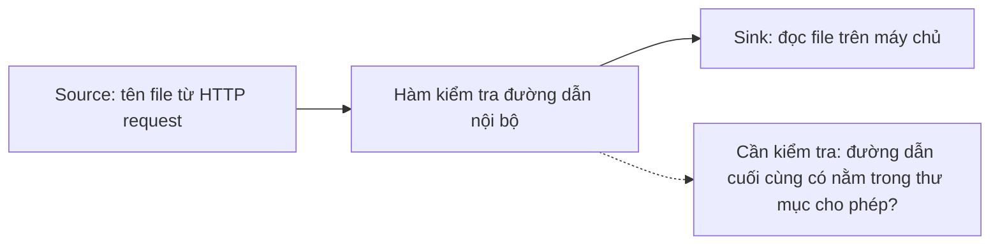
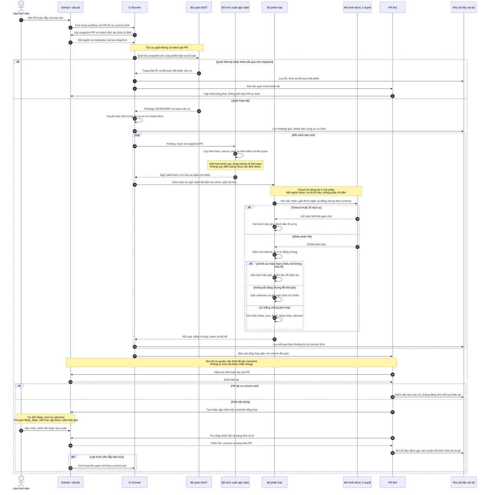
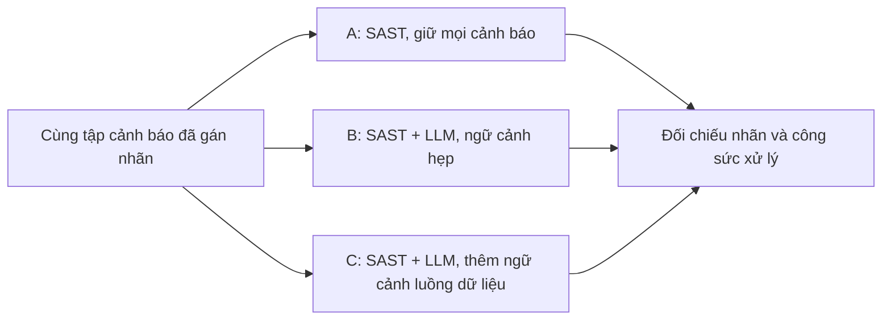

# Đề xuất: Trợ lý phân loại cảnh báo bảo mật trên Pull Request

## 1. Tóm tắt

Đề xuất xây dựng trợ lý phân loại cảnh báo bảo mật tại thời điểm review Pull Request/Merge Request (PR/MR). Hệ thống kết hợp công cụ phân tích tĩnh (SAST) với mô hình ngôn ngữ lớn (LLM), bổ sung ngữ cảnh **nguồn dữ liệu không tin cậy (Source) – bước kiểm tra/làm sạch (Sanitizer) – thao tác nhạy cảm (Sink)** để hỗ trợ kỹ sư xác minh cảnh báo.

Sản phẩm được chạy thử tại doanh nghiệp trong tháng triển khai. Mục tiêu là **giảm thời gian xử lý cảnh báo sai, đo nguy cơ đánh giá nhầm lỗi thật và xác định chi phí vận hành**. Hiệu quả là giả thuyết cần kiểm chứng; hệ thống giữ mọi cảnh báo gốc để kỹ sư tra cứu.

## 2. Phát biểu bài toán

Công cụ SAST có thể báo sai khi thiếu hiểu biết về hàm kiểm tra nội bộ hoặc luồng xử lý đặc thù. LLM chỉ nhận vài dòng quanh cảnh báo cũng có thể thiếu bằng chứng để đánh giá. Nhóm sẽ khảo sát và đo hiện trạng tại Z trước khi xác nhận mức độ của vấn đề.

Ví dụ, một chức năng tải file có luồng xử lý:

Tên hàm có chữ `safe` hoặc `validate` chưa chứng minh dữ liệu đã an toàn. Cần đọc phần cài đặt và điều kiện sử dụng của hàm đó.

**Bài toán:** Bổ sung ngữ cảnh chương trình có giúp LLM phân loại cảnh báo chính xác hơn và giúp kỹ sư xử lý nhanh hơn với chi phí chấp nhận được không?

**Đóng góp dự kiến:** bộ trích xuất ngữ cảnh có giới hạn cho stack của Z; thí nghiệm đối chứng về tác dụng của ngữ cảnh; quy trình tích hợp CI và số liệu triển khai thực tế. Nguyên tắc nghiên cứu: nhận định phải có bằng chứng, dữ liệu đánh giá tách khỏi dữ liệu phát triển, kết quả âm vẫn được báo cáo.

## 3. Phạm vi và điều kiện triển khai

| Hạng mục | Phạm vi cam kết |
|---|---|
| Dự án | Một ngôn ngữ/framework, 1–2 repo; chốt trong tuần 1 |
| Loại lỗi | 2–3 CWE liên quan luồng dữ liệu, chọn theo dữ liệu quét thử: SQL injection, path traversal hoặc SSRF |
| Công cụ | Một SAST chính và một mô hình LLM phù hợp chính sách Z |
| Hoạt động | Quét snapshot mã, so với nhánh đích để phân loại cảnh báo mới; dùng lịch sử PR cho đánh giá |
| Giới hạn | Không tự động sửa code, không chặn merge, không tự động xóa cảnh báo; không làm SCA, secret scanning hay huấn luyện mô hình |

**Điều kiện từ doanh nghiệp:** quyền đọc mã nguồn và lịch sử PR trong phạm vi được duyệt; runner chạy CI; quyền ghi comment riêng cho bot; một đầu mối kỹ thuật hỗ trợ xác minh mẫu và xác nhận triển khai. Chế độ chạy ngầm chỉ cần quyền đọc, chưa cần quyền comment.

**Dữ liệu:** xử lý trong hạ tầng Z; chỉ dùng API LLM bên ngoài khi được Z cho phép rõ phạm vi dữ liệu. Trích đoạn nhỏ và che secret giúp giảm dữ liệu gửi đi nhưng không bảo đảm loại hết thông tin nhạy cảm. Nếu không được dùng cloud, chọn mô hình nội bộ sau khi kiểm tra tài nguyên. Mã nguồn, prompt chứa code và log thô không đưa lên repo public; chỉ công bố số liệu được Z duyệt.

## 4. Phương án triển khai

**Trích xuất ngữ cảnh là trọng tâm kỹ thuật.** Ưu tiên trace do SAST cung cấp; dùng AST lấy thân hàm chứa finding và định nghĩa các hàm liên quan. Giới hạn số bước gọi, dung lượng ngữ cảnh và thời gian xử lý. AST giúp xác định cấu trúc mã, không tự chứng minh đầy đủ luồng dữ liệu xuyên hàm/file. Ngữ cảnh không giải được phải được đánh dấu thiếu và cho phép kết quả `unknown`.

**Đầu ra LLM:** JSON được kiểm tra bằng schema, gồm `finding_id`, `label` (`likely_true`, `likely_false`, `unknown`), `explanation` ngắn, `evidence` (file, dòng, nhận xét) và `missing_context`. Bằng chứng phải tham chiếu mã đã cung cấp; không yêu cầu chuỗi suy luận nội bộ.

**Hiển thị:** cảnh báo có vẻ đúng và chưa rõ được đặt trước; nhóm có vẻ sai được thu gọn nhưng vẫn xem được. Mọi finding gắn với commit đã quét. Timeout hoặc JSON không hợp lệ được ghi nhận là lỗi xử lý và giữ cảnh báo gốc. Nội dung repo là dữ liệu không tin cậy; thành phần phân loại không có quyền chạy lệnh hay sửa mã.

## 5. Open-source có thể dùng

| Khâu | Lựa chọn dự kiến | Cách tái sử dụng |
|---|---|---|
| SAST | Semgrep CE và bộ luật phù hợp | Lấy candidate findings, xuất JSON/SARIF; xác nhận giới hạn phân tích ngay khi quét thử |
| Trích xuất mã | AST chuẩn của ngôn ngữ hoặc Tree-sitter | Lấy thân hàm và vị trí; bổ sung trace có sẵn, không xây engine phân tích toàn chương trình |
| Chuẩn hóa và so sánh | Python, bộ đọc JSON/SARIF | Viết adapter mỏng; đối chiếu rule, đường dẫn và ngữ cảnh để xử lý thay đổi số dòng |
| LLM | SDK của backend được chọn, Pydantic | Gọi một mô hình, kiểm tra đầu ra, ghi token và độ trễ |
| CI và bot | GitHub Actions/PyGithub hoặc GitLab CI/python-gitlab | Chọn đúng nền tảng Z đang dùng, tái sử dụng cơ chế trigger và comment |

Chốt phiên bản và giấy phép bộ luật trước pilot. Semgrep CE có giới hạn về phân tích xuyên file [1]; CodeQL là phương án thay thế khi có điều kiện sử dụng phù hợp cho mã private [2]. CI dùng quyền tối thiểu và không cấp token ghi cho tác vụ chạy mã PR không tin cậy.

## 6. Cách thức đánh giá

Mục tiêu thu thập **150–250 cảnh báo duy nhất**, tùy kết quả khảo sát. Hai người gán nhãn độc lập trên tập đánh giá, giải quyết bất đồng và nhờ kỹ sư Z xác minh các ca cần hiểu dự án. Tách tập phát triển/đánh giá theo thời gian hoặc repo, tránh để finding cùng nguyên nhân xuất hiện ở cả hai tập.

| Câu hỏi nghiên cứu | Phương pháp và chỉ số |
|---|---|
| **RQ1. Ngữ cảnh bổ sung có cải thiện phân loại?** | So sánh A/B/C trên cùng tập; B/C dùng cùng mô hình và thiết lập. Đo precision của nhóm giữ lại, tỷ lệ nhận diện cảnh báo sai, tỷ lệ đánh giá nhầm lỗi thật và tỷ lệ `unknown` |
| **RQ2. Có giảm thời gian review?** | Chia các cảnh báo tương đương cho các phiên có/không có trợ lý, hoán đổi thứ tự và tránh cho một người xem lại cùng ca. Đo phút/cảnh báo cùng độ đúng quyết định, kể cả thời gian kiểm tra giải thích AI |
| **RQ3. Có phù hợp quy trình doanh nghiệp?** | Pilot trên PR mới trong 1–2 tuần; đo độ trễ p50/p95 nếu đủ lượt chạy, chi phí/PR, tỷ lệ chạy thành công, phản hồi và tỷ lệ xử lý trong cửa sổ quan sát cố định |

Quy ước: `unknown` được giữ lại để review. **Tỷ lệ đánh giá nhầm lỗi thật = số cảnh báo đúng bị gán `likely_false` / tổng cảnh báo đúng trong tập SAST đã thẩm định.** Chỉ số này không đo các lỗ hổng SAST chưa phát hiện. Việc dev bỏ qua không được coi là nhãn cảnh báo sai; việc sửa phải được kiểm tra có liên quan tới finding.

Báo cáo mẫu số, khoảng tin cậy và kết quả theo CWE; nhóm các finding lặp theo nguyên nhân khi phân tích. Nếu mẫu ít, trình bày giới hạn thay vì kết luận hiệu quả rộng. Bằng chứng dùng để chỉnh hệ thống không được dùng lại làm tập chấm cuối, kế thừa nguyên tắc đánh giá độc lập của P2Patch [3].

**Tài liệu tham khảo**

[1] Semgrep, [Join mode overview — giới hạn Community Edition](https://semgrep.dev/docs/writing-rules/experiments/join-mode/overview).

[2] GitHub, [CodeQL CLI — điều kiện sử dụng](https://docs.github.com/en/code-security/concepts/code-scanning/codeql/codeql-cli).

[3] M. Iranmanesh và cộng sự, [P2Patch: Exploit-Guided Vulnerability Repair](https://arxiv.org/html/2610.20245v1), 2026.
